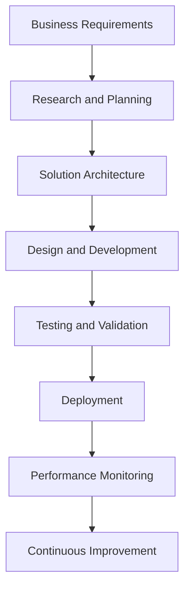

# SHIVAM YADAV

### IT, Accounts & Business Operations Professional

**Software Development · Digital Marketing · B2B Sales**

**Founder & Software Developer — NEXURAX**

*Bridging Technology, Finance and Business Innovation.*

Thane, Maharashtra, India

[Official Website](https://www.nexurax.in/) •
[Software Downloads](https://github.com/sy97210415-coder/nexurax-downloads/releases) •
[Contact Me](https://www.nexurax.in/p/contact.html)

---

[About Me](#professional-summary) |
[Experience](#professional-experience) |
[Expertise](#professional-expertise) |
[Projects](#software-project-portfolio) |
[Education](#education--certifications)

---

## Professional Summary

I am a multidisciplinary professional with nearly two years of experience across accounting, finance, information technology, multi-branch business operations and industrial B2B sales.

My professional background combines financial operations, software development, digital marketing and business process automation, enabling me to understand business challenges from both operational and technological perspectives.

I have practical experience in accounts payable, supplier payments, financial reconciliation, purchase accounting, industrial sales, customer relationship management and digital business solutions.

As the Founder of **NEXURAX — IT Solutions & Services**, I focus on developing practical software products that simplify business operations, improve productivity and support digital transformation.

Currently pursuing a Bachelor of Computer Applications (BCA) from Indira Gandhi National Open University (IGNOU).

---

## Career Highlights

<table>
<tr>
<td align="center" width="25%">
<h2>~2 Years</h2>
Professional Experience
</td>
<td align="center" width="25%">
<h2>26+</h2>
Retail Branch Operations
</td>
<td align="center" width="25%">
<h2>10</h2>
Selected Software Projects
</td>
<td align="center" width="25%">
<h2>02</h2>
Professional Certifications
</td>
</tr>
</table>

---

## Professional Experience

### TRICON STEEL & ALLOYS

**B2B Sales & Business Development**

Mumbai, Maharashtra, India

`05 October 2026 – Present`

#### Business Development & Sales

- Manage domestic and international B2B lead generation and business development activities.
- Handle customer inquiries, RFQs, commercial quotations, pricing and negotiations.
- Conduct industrial market research and identify potential buyers and end-users.
- Execute email and WhatsApp marketing campaigns for customer acquisition.
- Coordinate with suppliers regarding material availability, pricing and procurement.
- Maintain customer databases, inquiry records and commercial documentation.
- Support customer relationship management and sales process automation.

#### Industrial Product Knowledge

| Material Categories | Product Categories |
| :--- | :--- |
| Stainless Steel | Pipes & Tubes |
| Carbon Steel | Pipe Fittings |
| Alloy Steel | Industrial Flanges |
| Industrial Metals | Sheets & Plates |

**Core Focus:** B2B Sales, Industrial Marketing, RFQ Management, Commercial Operations and Customer Acquisition.

---

### GAURAV SWEETS & NAMKEENS

**Accounts, IT & Operations Department**

Thane, Maharashtra, India

`27 December 2024 – 10 September 2026`

#### Accounting & Financial Management

- Managed accounting, financial and operational activities across 26+ retail branches.
- Processed supplier and vendor payments through Cheque, NEFT and online bank transfers.
- Managed accounts payable, purchase bill verification and payment vouchers.
- Maintained supplier ledgers, outstanding payments and financial documentation.
- Prepared cheques and maintained paid and unpaid bill records.
- Managed vendor commission calculations and payment settlements.

#### Financial Reconciliation & Auditing

- Conducted Daily Cash Declaration (DCD) audits and branch-wise financial reconciliation.
- Reconciled cash, cheque, UPI, credit card and debit card transactions.
- Verified counter-wise sales, commission calculations and vendor settlements.
- Maintained financial reporting and digital payment reconciliation records.

| Payment Category | Platforms |
| :--- | :--- |
| Banking | ICICI Bank |
| Digital Payments | Paytm, Pine Labs |
| Corporate Payments | Sodexo, AMEX |
| Online Aggregators | Swiggy, Zomato |
| Retail Management | GoFrugal POS |

#### Information Technology & Business Operations

- Worked with GoFrugal POS, item master data, inventory records and sales reports.
- Coordinated with branch managers, cashiers, suppliers and internal departments.
- Provided technical support and resolved software-related operational issues.
- Developed internal software tools for financial reporting and workflow automation.
- Designed attendance, payroll, salary calculation and advance management systems.
- Supported multi-branch operational management and digital reporting.

#### Internal Technology Initiatives

| Project | Business Application |
| :--- | :--- |
| Daily Cash Declaration System | Branch-wise Cash Reporting |
| Financial Reconciliation Tools | Financial Verification |
| Vendor Commission Settlement | Commission & Payment Management |
| Attendance & Payroll System | Employee Management |
| Salary & Advance Management | Payroll Operations |
| Workflow Automation | Business Process Improvement |

**Core Focus:** Accounting, Financial Reconciliation, Retail Operations, IT Support and Business Automation.

---

### NEXURAX — IT SOLUTIONS & SERVICES

**Founder & Software Developer**

`Independent Technology Venture`

Official Website: [www.nexurax.in](https://www.nexurax.in/)

NEXURAX is an independent technology venture focused on developing business-oriented software products, productivity applications and digital automation solutions.

#### Product Development & Technology

- Develop Windows desktop, web and Android applications.
- Design software solutions for accounting, billing, CRM, HRMS and payroll.
- Develop database-driven applications and Chrome extensions.
- Build responsive websites and digital business platforms.
- Work on API integration, software integration and AI-assisted development.
- Manage software architecture, product planning and feature development.
- Focus on practical user experience and business workflow optimization.

#### Digital Marketing & Business Growth

- Conduct SEO ranking analysis and keyword research.
- Monitor website search visibility and performance.
- Manage Meta Ads and digital marketing campaigns.
- Monitor website traffic using Google Analytics.
- Develop email marketing and customer acquisition solutions.
- Manage software product branding and digital promotion.

**Core Focus:** Software Engineering, Business Automation, Product Development and Digital Innovation.

---

## Professional Expertise

### Accounting & Finance

| Competency | Professional Skills |
| :--- | :--- |
| Accounts Payable | Supplier & Vendor Payments |
| Banking Operations | Cheque, NEFT & Online Transfers |
| Purchase Accounting | Purchase Bill Verification |
| Financial Documentation | Payment Vouchers & Supplier Ledgers |
| Financial Reconciliation | Cash, Bank & Digital Payments |
| Outstanding Management | Paid & Unpaid Bill Tracking |
| Taxation | GST Billing |
| Financial Reporting | Branch-wise Financial Reports |
| Vendor Management | Commission & Payment Settlement |

### Software Development & IT

| Technology Category | Technologies |
| :--- | :--- |
| Programming Languages | JavaScript, C# |
| Web Development | HTML5, CSS3, JavaScript |
| Backend Development | Node.js |
| Desktop Development | Electron.js, .NET, WinForms |
| Database Management | SQLite |
| Cloud Automation | Google Apps Script |
| Mobile Development | Android Applications |
| Browser Development | Chrome Extensions |
| Software Integration | API Integration |
| Development Approach | AI-Assisted Development |
| Technical Operations | IT Support & Troubleshooting |

### Digital Marketing & SEO

- Search Engine Optimization (SEO)
- Keyword Research & Ranking Analysis
- Website SEO Auditing
- Competitor Research
- Google Search Ranking Monitoring
- Meta Ads Manager
- Facebook & Instagram Advertising
- Google Analytics (GA4)
- Website Traffic Analysis
- Social Media Marketing
- Email Marketing
- WhatsApp Marketing
- Online Lead Generation
- Digital Branding

### B2B Sales & Business Development

- Domestic & International Lead Generation
- Industrial Market Research
- Customer Inquiry Management
- RFQ & Quotation Preparation
- Commercial Follow-up
- Customer Relationship Management
- Supplier Coordination
- Procurement Support
- Sales Documentation
- B2B Marketing & Customer Acquisition

### Business Operations & Automation

- Multi-Branch Business Management
- Retail Operations
- Inventory Management
- POS Management
- Financial Workflow Automation
- Digital Reporting
- Browser Automation
- Marketing Automation
- Data Management
- Business Process Optimization

---

## Technology Stack

### Programming & Development

`JavaScript` · `C#` · `HTML5` · `CSS3`

### Frameworks & Platforms

`Node.js` · `Electron.js` · `.NET` · `WinForms` · `Android`

### Database & Integration

`SQLite` · `Google Apps Script` · `REST API`

### Development Environment

`GitHub` · `Visual Studio` · `VS Code` · `Google AI Studio`

### Marketing & Analytics

`Meta Ads` · `Google Analytics` · `Google AdMob` · `SEO`

### Business & Productivity

`Microsoft Excel` · `Microsoft Word` · `Google Sheets` · `GoFrugal POS`

---

## Software Project Portfolio

<table>
<tr>
<td width="50%" valign="top">

<h3>NEXURAX MailDesk</h3>

<strong>Email Marketing & Business Outreach</strong>

Professional email marketing and personalized business outreach automation software.

<code>Windows</code> <code>Marketing</code> <code>Automation</code>

</td>
<td width="50%" valign="top">

<h3>NEXURAX MultiChat</h3>

<strong>Multi-WhatsApp Management</strong>

Centralized application for managing multiple WhatsApp accounts and business communication.

<code>Windows</code> <code>Communication</code>

</td>
</tr>

<tr>
<td width="50%" valign="top">

<h3>NEXURAX LeadDesk</h3>

<strong>B2B Lead Management</strong>

Business lead management, customer follow-up and sales productivity solution.

<code>Windows</code> <code>CRM</code> <code>B2B</code>

</td>
<td width="50%" valign="top">

<h3>NEXURAX RankDesk</h3>

<strong>SEO & Ranking Analysis</strong>

Website SEO checking, keyword ranking analysis and search visibility monitoring.

<code>Chrome</code> <code>SEO</code> <code>Analytics</code>

</td>
</tr>

<tr>
<td width="50%" valign="top">

<h3>NEXURAX FinPrint</h3>

<strong>Professional Cheque Printing</strong>

Cheque printing, financial record management and payment documentation software.

<code>Windows</code> <code>Finance</code>

</td>
<td width="50%" valign="top">

<h3>NEXURAX CatalogPilot</h3>

<strong>Product Catalogue Automation</strong>

Browser-based product catalogue management and business workflow automation.

<code>Chrome</code> <code>Automation</code>

</td>
</tr>

<tr>
<td width="50%" valign="top">

<h3>DocScanX</h3>

<strong>PDF Scanner, Creator & Editor</strong>

Android application for document scanning, PDF creation and document editing.

<code>Android</code> <code>PDF</code> <code>Productivity</code>

</td>
<td width="50%" valign="top">

<h3>Daily Cash Declaration System</h3>

<strong>Multi-Branch Financial Reporting</strong>

Branch-wise cash reporting, financial verification and payment reconciliation system.

<code>Finance</code> <code>Retail</code>

</td>
</tr>

<tr>
<td width="50%" valign="top">

<h3>Vendor Commission Settlement</h3>

<strong>Vendor Payment Management</strong>

Commission calculation, counter-wise settlement and vendor payment management solution.

<code>Accounting</code> <code>Finance</code>

</td>
<td width="50%" valign="top">

<h3>Office Workflow Management</h3>

<strong>Inquiry, Quotation & CRM</strong>

Integrated business inquiry, quotation and customer follow-up management solution.

<code>CRM</code> <code>Under Development</code>

</td>
</tr>
</table>

### Explore NEXURAX Software

**[Official Website](https://www.nexurax.in/)**

**[Download Software & View Releases](https://github.com/sy97210415-coder/nexurax-downloads/releases)**

---

## Additional Product Initiatives

| Product | Solution |
| :--- | :--- |
| NEXURAX MailDesk Web | Gmail & Outlook Email Productivity Extension |
| NEXURAX MenuDesk | Restaurant Menu Management |
| NEXURAX AttendDesk | Attendance & Payroll Management |
| NEXURAX POS | Retail & Restaurant Billing Solutions |

---

## Education & Certifications

### Bachelor of Computer Applications (BCA)

**Indira Gandhi National Open University (IGNOU)**

`Currently Pursuing`

Academic focus on computer applications, software development, information technology and database management.

### Professional Certifications

| Certification | Qualification | Year |
| :--- | :--- | :--- |
| Field Technician – Computing & Peripherals | NSQF Level 4 | August 2024 |
| Web Design & Development | NSQF Level 5 | — |

---

## Core Professional Strengths

<table>
<tr>
<td width="50%">

- Analytical Thinking
- Problem Solving
- Financial Accuracy
- Attention to Detail

</td>
<td width="50%">

- Technical Troubleshooting
- Team Coordination
- Time Management
- Continuous Learning

</td>
</tr>
<tr>
<td>

- Business Process Management
- Customer Relationship Management

</td>
<td>

- Adaptability
- Technology-Driven Innovation

</td>
</tr>
</table>

---

## Professional Development Approach

My approach combines business understanding, financial accuracy and practical software engineering to develop solutions that address real operational challenges.

---

## About NEXURAX

# NEXURAX

### IT SOLUTIONS & SERVICES

**POWERING NEXT GEN TECH**

*Innovative Software. Intelligent Automation. Better Business.*

NEXURAX focuses on developing practical technology solutions that simplify business processes, improve productivity and support digital transformation.

| Business Domain | Technology Solutions |
| :--- | :--- |
| Software Engineering | Desktop, Web & Android Applications |
| Financial Technology | Accounting, Billing & Cheque Printing |
| Business Management | CRM, HRMS, Payroll & POS |
| Digital Marketing | Email Marketing & SEO Tools |
| Business Automation | Workflow & Browser Automation |
| Communication | Multi-Account Communication Tools |
| Product Development | Business Productivity Applications |

### Mission

To make professional technology accessible through reliable, practical and user-friendly software solutions.

### Vision

To build a technology ecosystem that connects business requirements with meaningful digital innovation.

**[Visit NEXURAX Official Website](https://www.nexurax.in/)**

---

## Professional Interests

- Software Engineering & Product Development
- Accounting & Financial Technology
- Artificial Intelligence & Business Automation
- Digital Marketing & Data Analytics
- Enterprise Business Management
- Industrial B2B Sales & International Markets
- Technology Entrepreneurship
- Business Process Digitalization

---

## Languages & Location

| Information | Details |
| :--- | :--- |
| Languages | Hindi & English |
| Nationality | Indian |
| Location | Thane, Maharashtra, India |

---

## Connect With Me

| Platform | Official Link |
| :--- | :--- |
| Website | [www.nexurax.in](https://www.nexurax.in/) |
| GitHub | [Shivam Yadav](https://github.com/sy97210415-coder) |
| Software Downloads | [NEXURAX Releases](https://github.com/sy97210415-coder/nexurax-downloads/releases) |
| Business Inquiries | [Contact NEXURAX](https://www.nexurax.in/p/contact.html) |
| Privacy Policy | [View Privacy Policy](https://www.nexurax.in/p/privacy-policy.html) |
| Terms & Conditions | [View Terms](https://www.nexurax.in/p/terms.html) |

---

## Let's Build Something Meaningful Together

Open to professional opportunities, software projects, business collaborations and technology partnerships.

**Technology · Finance · Business · Innovation**

---

### SHIVAM YADAV

**IT, Accounts & Business Operations Professional**

Founder — NEXURAX

*Building Technology. Empowering Businesses.*

[Official Website](https://www.nexurax.in/) •
[Contact Me](https://www.nexurax.in/p/contact.html)

---

Copyright © 2026 Shivam Yadav | NEXURAX. All Rights Reserved.

