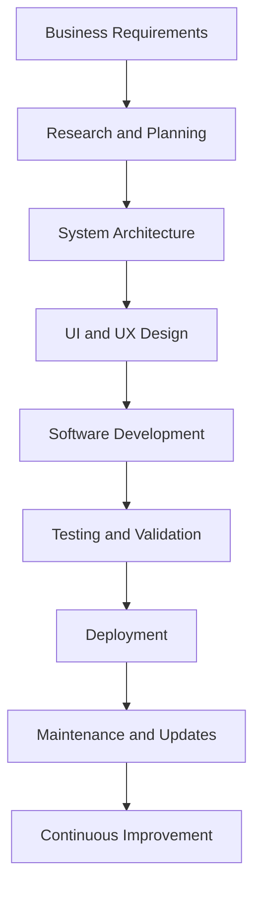

# SHIVAM YADAV

### Founder of NEXURAX | Full-Stack Developer
### Business Solutions Architect

**Building Technology. Empowering Businesses.**

[Official Website](https://www.nexurax.in/) |
[Software Downloads](https://github.com/sy97210415-coder/nexurax-downloads/releases) |
[Contact](https://www.nexurax.in/p/contact.html)

**Thane, Maharashtra, India**

---

## 01. Professional Overview

I am a software developer, technology entrepreneur and Founder of **NEXURAX — IT Solutions & Services**.

My work focuses on transforming practical business requirements into professional software products, intelligent automation systems and user-friendly digital solutions.

I combine software development with business operations knowledge to create applications that simplify workflows, improve productivity and support digital transformation.

| Professional Profile | Details |
| :--- | :--- |
| Name | Shivam Yadav |
| Designation | Founder & Software Developer |
| Organization | NEXURAX |
| Specialization | Business Solutions Architecture |
| Education | Bachelor of Computer Applications — Pursuing |
| Location | Thane, Maharashtra, India |
| Development Focus | Desktop, Web, Mobile & Browser Applications |
| Official Website | [www.nexurax.in](https://www.nexurax.in/) |

---

## 02. NEXURAX — IT Solutions & Services

# NEXURAX

### POWERING NEXT GEN TECH

**Innovative Software. Intelligent Automation. Better Business.**

NEXURAX is a technology brand focused on developing professional business software, productivity applications, browser extensions and digital solutions.

### Our Vision

To make professional technology accessible to businesses through practical, reliable and innovative software solutions.

### Our Mission

To simplify complex business operations through thoughtful software engineering, intelligent automation and continuous product improvement.

### Core Values

- Innovation and continuous improvement
- Business-first software development
- User-centric product design
- Responsible automation
- Data privacy and security
- Reliability and performance

**[Explore NEXURAX Official Website](https://www.nexurax.in/)**

---

## 03. Software Product Ecosystem

<table>
<tr>
<td width="50%" valign="top">

<h3>NEXURAX MailDesk</h3>

Professional email marketing and business outreach software.

<ul>
<li>Personalized email campaigns</li>
<li>Excel and CSV contact import</li>
<li>Email templates</li>
<li>Campaign management</li>
<li>Business communication</li>
</ul>

</td>
<td width="50%" valign="top">

<h3>NEXURAX MailDesk Web</h3>

Browser-based email productivity extension for Gmail and Outlook.

<ul>
<li>Spreadsheet contact import</li>
<li>Personalized email workflows</li>
<li>Email attachments</li>
<li>Sending interval controls</li>
<li>Campaign reports</li>
</ul>

</td>
</tr>

<tr>
<td width="50%" valign="top">

<h3>NEXURAX LeadDesk</h3>

B2B lead management and sales productivity software.

<ul>
<li>Business lead management</li>
<li>Smart lead filtering</li>
<li>Customer follow-up</li>
<li>Sales productivity</li>
<li>Lead organization</li>
</ul>

</td>
<td width="50%" valign="top">

<h3>NEXURAX MultiChat</h3>

Professional multi-WhatsApp account management software.

<ul>
<li>Multiple WhatsApp accounts</li>
<li>Dedicated account sessions</li>
<li>QR code login</li>
<li>Unread message notifications</li>
<li>Centralized communication</li>
</ul>

</td>
</tr>

<tr>
<td width="50%" valign="top">

<h3>NEXURAX FinPrint</h3>

Professional cheque printing and financial productivity software.

<ul>
<li>Single and bulk cheque printing</li>
<li>Custom bank layouts</li>
<li>Amount-to-words conversion</li>
<li>Cheque printing history</li>
<li>Print preview</li>
</ul>

</td>
<td width="50%" valign="top">

<h3>NEXURAX RankDesk SEO</h3>

Search engine ranking and SEO analysis tools.

<ul>
<li>Keyword ranking analysis</li>
<li>Search visibility monitoring</li>
<li>Website analysis</li>
<li>SEO productivity workflows</li>
</ul>

</td>
</tr>

<tr>
<td width="50%" valign="top">

<h3>NEXURAX CatalogPilot</h3>

IndiaMART catalog management and business productivity extension.

<ul>
<li>Product catalog management</li>
<li>Bulk product operations</li>
<li>Product matching</li>
<li>Catalog workflow automation</li>
</ul>

</td>
<td width="50%" valign="top">

<h3>NEXURAX MenuDesk</h3>

Restaurant menu management and operational productivity solutions.

<ul>
<li>Restaurant menu management</li>
<li>Menu comparison</li>
<li>Product information management</li>
<li>Restaurant productivity</li>
</ul>

</td>
</tr>

<tr>
<td colspan="2" valign="top">

<h3>DocScanX</h3>

Modern PDF scanner, creator and document editing application.

<ul>
<li>Document scanning and PDF creation</li>
<li>Image enhancement and cropping</li>
<li>PDF page management</li>
<li>Document editing and organization</li>
</ul>

</td>
</tr>
</table>

**[Explore Official Software Downloads](https://github.com/sy97210415-coder/nexurax-downloads/releases)**

---

## 04. Technology Stack

### Programming Languages

### Frontend Development

### Backend & Desktop Development

### Mobile & Browser Development

### Database & Development Tools

### Business & Productivity Tools

---

## 05. Engineering Capabilities

| Domain | Capabilities |
| :--- | :--- |
| Desktop Engineering | Windows applications and desktop utilities |
| Web Development | Responsive websites and business applications |
| Browser Engineering | Chrome extensions and productivity tools |
| Mobile Development | Android applications and mobile utilities |
| Business Automation | Workflow automation and data processing |
| Financial Software | Billing, GST and cheque printing systems |
| CRM Systems | Lead management and customer follow-up |
| HRMS & Payroll | Attendance, salary and employee management |
| Retail Solutions | POS, inventory and business reporting |
| Database Management | SQLite and structured data systems |
| Software Architecture | Modular and offline-first applications |
| Product Development | UI/UX, planning, testing and deployment |

---

## 06. Software Development Process

My development approach focuses on understanding real business requirements, creating practical software architecture and continuously improving application reliability and user experience.

---

## 07. Education & Professional Development

| Qualification | Details |
| :--- | :--- |
| Bachelor of Computer Applications | Pursuing |
| Computing & Peripherals | NSQF Level 4 |
| Web Design & Development | NSQF Level 5 |
| Professional Focus | Software Development & Business Technology |

---

## 08. Current Development Focus

- Expanding the NEXURAX software ecosystem
- Professional business management applications
- Windows desktop software development
- Android productivity applications
- Browser-based business automation
- AI-assisted business workflows
- Offline-first software architecture
- Secure database management
- Software distribution and version management
- Continuous product improvement

---

## 09. GitHub Statistics

### Contribution Streak

### Contribution Activity

[View GitHub Profile and Contributions](https://github.com/sy97210415-coder)

---

## 10. Featured Repositories

| Repository | Description |
| :--- | :--- |
| [SHIVAM](https://github.com/sy97210415-coder/SHIVAM) | Professional Developer Portfolio |
| [nexurax-downloads](https://github.com/sy97210415-coder/nexurax-downloads) | Official Software Distribution |
| [NEXURAX Releases](https://github.com/sy97210415-coder/nexurax-downloads/releases) | Software Installers & Version Updates |

Public software distribution is separated from proprietary commercial source code.

---

## 11. Business & Technology Collaboration

I am interested in technology collaborations and software projects that solve practical business challenges.

### Services & Collaboration Opportunities

- Custom Business Software Development
- Windows Desktop Application Development
- Full-Stack Web Application Development
- Android Application Development
- Chrome Extension Development
- Business Workflow Automation
- CRM & Lead Management Solutions
- Billing & Financial Management Software
- HRMS & Payroll Solutions
- Retail & Inventory Management
- Software Integration
- Digital Transformation Solutions

**[Discuss Your Project With NEXURAX](https://www.nexurax.in/p/contact.html)**

---

## 12. Official Links & Resources

| Resource | Official Link |
| :--- | :--- |
| Company Website | [www.nexurax.in](https://www.nexurax.in/) |
| Developer Profile | [GitHub Profile](https://github.com/sy97210415-coder) |
| Professional Portfolio | [SHIVAM Portfolio](https://github.com/sy97210415-coder/SHIVAM) |
| Software Downloads | [GitHub Releases](https://github.com/sy97210415-coder/nexurax-downloads/releases) |
| Business Inquiries | [Contact NEXURAX](https://www.nexurax.in/p/contact.html) |
| Privacy Policy | [Privacy Policy](https://www.nexurax.in/p/privacy-policy.html) |
| Terms & Conditions | [Terms & Conditions](https://www.nexurax.in/p/terms.html) |

---

## Engineering Ideas Into Reality

Technology is not just about writing code.

It is about creating meaningful solutions that make businesses better.

---

# NEXURAX

### IT SOLUTIONS & SERVICES

**POWERING NEXT GEN TECH**

Software Engineering | Business Automation | Digital Innovation

**[www.nexurax.in](https://www.nexurax.in/)**

Copyright © 2026 NEXURAX. All Rights Reserved.

