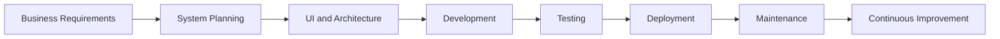

 

### Transforming Business Challenges Into Technology Solutions.

---

## 01 — Professional Overview

I am a software developer, technology entrepreneur and Founder of **NEXURAX — IT Solutions & Services**.

I work at the intersection of software engineering, business operations and digital innovation, developing practical technology solutions that simplify complex workflows and improve business productivity.

My development interests include Windows desktop applications, web platforms, browser extensions, Android applications and business automation systems.

### Professional Profile

| Information | Details |
| :--- | :--- |
| Name | Shivam Yadav |
| Position | Founder & Software Developer |
| Organization | NEXURAX — IT Solutions & Services |
| Specialization | Business Solutions Architecture |
| Education | Bachelor of Computer Applications — Pursuing |
| Location | Thane, Maharashtra, India |
| Website | [www.nexurax.in](https://www.nexurax.in/) |
| Collaboration | Software Projects & Business Solutions |

---

## 02 — NEXURAX

# N E X U R A X

### IT Solutions & Services

**POWERING NEXT GEN TECH**

NEXURAX is a technology brand focused on developing professional software products, business automation systems and digital solutions for modern businesses.

### Vision

To build a technology ecosystem that makes professional software accessible, efficient and practical for businesses.

### Mission

To simplify business operations through intelligent software, thoughtful engineering and reliable digital solutions.

### Core Principles

- Business-first software development
- User-centric product design
- Practical and reliable technology
- Data privacy and responsible automation
- Continuous product improvement

---

## 03 — Software Product Ecosystem

| 9 | 3 | 1 |
| :---: | :---: | :---: |
| Product Portfolio | Core Platforms | Technology Brand |

<table>
<tr>
<td width="50%" valign="top">

### NEXURAX MailDesk

Professional email marketing and business outreach software.

- Personalized email campaigns
- Excel and CSV contact management
- Business communication workflows

</td>
<td width="50%" valign="top">

### NEXURAX MailDesk Web

Browser-based email outreach for Gmail and Outlook.

- Personalized email workflows
- Spreadsheet contact import
- Campaign management

</td>
</tr>

<tr>
<td width="50%" valign="top">

### NEXURAX LeadDesk

B2B lead management and sales productivity software.

- Business lead management
- Smart lead filtering
- Customer follow-up workflows

</td>
<td width="50%" valign="top">

### NEXURAX MultiChat

Centralized multi-WhatsApp account management.

- Multiple account sessions
- Unified communication workspace
- Business messaging management

</td>
</tr>

<tr>
<td width="50%" valign="top">

### NEXURAX FinPrint

Professional cheque printing and financial record management.

- Single and bulk cheque printing
- Custom bank cheque layouts
- Financial printing records

</td>
<td width="50%" valign="top">

### NEXURAX RankDesk SEO

Keyword ranking and search visibility analysis.

- Keyword position checking
- Bulk website analysis
- Ranking report export

</td>
</tr>

<tr>
<td width="50%" valign="top">

### NEXURAX CatalogPilot

IndiaMART catalog management and productivity tools.

- Bulk catalog operations
- Product matching and filtering
- Processing reports

</td>
<td width="50%" valign="top">

### NEXURAX MenuDesk

Restaurant menu management and operational productivity.

- Menu management workflows
- Product comparison
- Restaurant operations

</td>
</tr>

<tr>
<td colspan="2" valign="top">

### DocScanX

Modern document scanning, PDF creation and document editing application.

- Document scanning
- PDF creation and editing
- Image enhancement
- Document management

</td>
</tr>
</table>

---

## 04 — Engineering Capabilities

| Domain | Capabilities |
| :--- | :--- |
| Desktop Engineering | Windows Applications, Electron, Desktop Utilities |
| Web Development | Responsive Websites, Web Applications, Business Portals |
| Browser Engineering | Chrome Extensions, Browser-Based Productivity Tools |
| Mobile Development | Android Applications, Mobile Utilities |
| Business Automation | Workflow Automation, Data Processing, Reporting |
| Financial Software | Billing, Cheque Printing, Financial Records |
| Business Management | CRM, HRMS, Payroll, Inventory Management |
| Database Engineering | SQLite, Local Storage, Structured Data Management |
| Software Architecture | Modular Applications, Offline-First Systems |
| Product Development | UI/UX, Product Planning, Deployment & Maintenance |

---

## 05 — Technology Stack

### Programming Languages

### Frontend Engineering

### Backend & Desktop Engineering

### Mobile & Browser Platforms

### Database & Developer Tools

---

## 06 — Software Development Lifecycle

My development approach focuses on understanding business requirements, designing practical solutions, building reliable applications and continuously improving the user experience.

---

## 07 — Current Development Focus

- Expanding the NEXURAX software ecosystem
- Business productivity and enterprise applications
- Desktop software performance and reliability
- Android productivity and utility applications
- AI-assisted business workflows
- Offline-first application architecture
- Secure and efficient data management
- Professional software distribution and updates

---

## 08 — GitHub Engineering Activity

 

### Contribution Activity

---

## 09 — Featured Repositories

| Repository | Purpose |
| :--- | :--- |
| [SHIVAM](https://github.com/sy97210415-coder/SHIVAM) | Professional Developer Portfolio |
| [nexurax-downloads](https://github.com/sy97210415-coder/nexurax-downloads) | Official Software Distribution |
| [Software Releases](https://github.com/sy97210415-coder/nexurax-downloads/releases) | Application Installers & Version Updates |

Commercial software source code is maintained separately from public distribution repositories.

---

## 10 — Business & Technology Collaboration

I am interested in collaborating on technology projects that solve practical business problems.

### Collaboration Opportunities

- Custom Business Software Development
- Windows Desktop Application Development
- Chrome Extension Development
- Android Application Development
- Business Workflow Automation
- CRM and Financial Management Systems
- Software Integration
- Digital Transformation Projects

---

## 11 — Official Links

| Resource | Official Link |
| :--- | :--- |
| Company Website | [www.nexurax.in](https://www.nexurax.in/) |
| Developer Profile | [GitHub Profile](https://github.com/sy97210415-coder) |
| Professional Portfolio | [SHIVAM Portfolio](https://github.com/sy97210415-coder/SHIVAM) |
| Software Downloads | [NEXURAX Releases](https://github.com/sy97210415-coder/nexurax-downloads/releases) |
| Business & Technical Support | [Contact NEXURAX](https://www.nexurax.in/p/contact.html) |
| Privacy Policy | [Privacy Policy](https://www.nexurax.in/p/privacy-policy.html) |
| Terms & Conditions | [Terms & Conditions](https://www.nexurax.in/p/terms.html) |

---

## Engineering Ideas Into Reality.

Technology is not just about writing code.
It is about creating solutions that make a meaningful difference.

 

# N E X U R A X

### IT Solutions & Services

**POWERING NEXT GEN TECH**

[www.nexurax.in](https://www.nexurax.in/)

Copyright © 2026 NEXURAX. All Rights Reserved.

